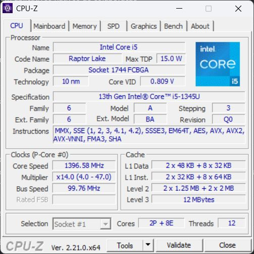
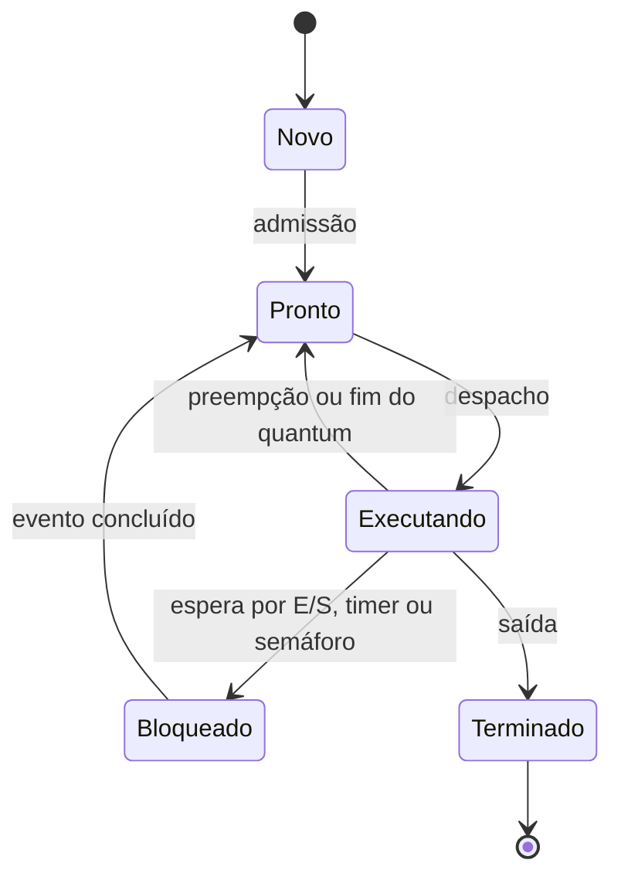
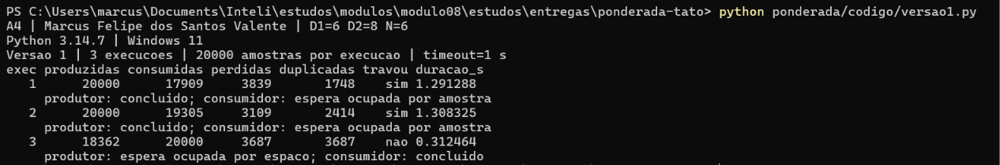
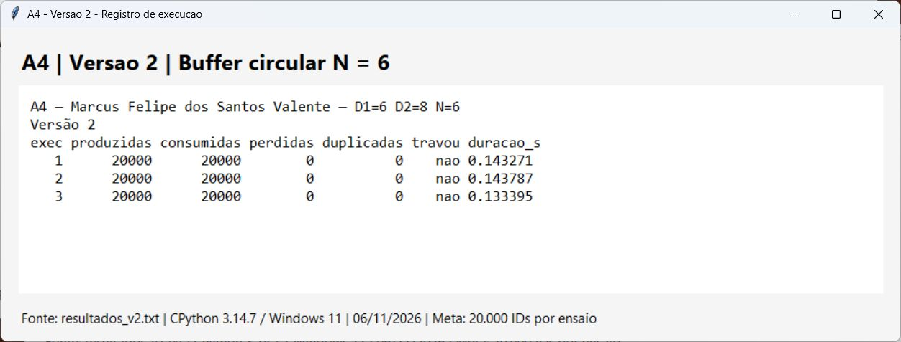
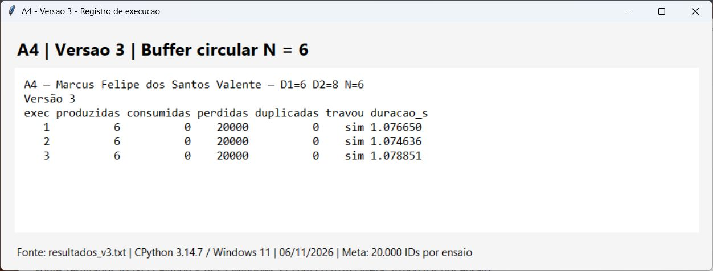
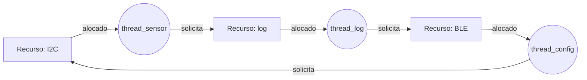

Marcus Felipe dos Santos Valente | D1 = 6 | D2 = 8 | N = 6

# Tato: do pipeline à decisão de produção

## Parte A: o problema técnico

### Parâmetros individuais

Contagem apenas das letras do nome: **Marcus (6) + Felipe (6) + dos (3) + Santos (6) + Valente (7) = 28**.

```text
D1 = 6
D2 = 28 mod 10 = 8
IC = 100.000 + 20.000 × 8 = 260.000 instruções/amostra
m  = 3% + 0,5% × 6 = 6% = 0,06
N  = 3 + (8 mod 5) = 3 + 3 = 6 posições
Período = 1 / 100 Hz = 0,01 s = 10 ms
Prazo por amostra = 5 ms
```

O período de 10 ms informa a frequência das leituras. Ele não autoriza processar uma amostra em 10 ms: o prazo exigido continua sendo 5 ms.

### A1: arquitetura e memória

#### 1. Plataforma H

O tempo de CPU é o número de instruções multiplicado pelo CPI, dividido pela frequência:

```text
T_H = IC × CPI / f
    = 260.000 × 1,5 / 48.000.000
    = 390.000 / 48.000.000 s
    = 0,008125 s = 8,125 ms

Excesso sobre o prazo = 8,125 − 5 = 3,125 ms
```

A H sem acelerador não atende: termina antes da próxima amostra, mas viola o prazo de 5 ms.

#### 2. Plataforma V

Adoto os 120 ciclos como **penalidade adicional de falta**, conforme a fórmula de CPI efetivo exigida pelo enunciado. O ciclo a 1,2 GHz dura:

```text
t_ciclo = 1 / 1.200.000.000 s = 0,833333 ns

AMAT = tempo de acerto + m × penalidade
     = 1 + 0,06 × 120
     = 8,2 ciclos/acesso
     = 8,2 × 0,833333 ns = 6,833333 ns/acesso

CPI_efetivo = 1,0 + 1,3 × m × 120
            = 1,0 + 1,3 × 0,06 × 120
            = 1,0 + 9,36 = 10,36 ciclos/instrução

Ciclos/amostra = 260.000 × 10,36 = 2.693.600
T_V = 2.693.600 / 1.200.000.000 s
    = 0,0022446667 s = 2,244667 ms

T_V com atraso máximo do SO = 2,244667 + 3
                           = 5,244667 ms
Excesso sobre o prazo = 0,244667 ms
```

O processamento médio calculado fica abaixo de 5 ms, mas a V não atende ao limite com o atraso máximo de SO do exercício. O clock maior não elimina as paradas da memória nem as interrupções do Linux.

Se os 120 ciclos fossem o custo total de uma falta, o AMAT seria `0,94 × 1 + 0,06 × 120 = 8,14 ciclos`, mas usei a convenção de penalidade adicional pedida no enunciado. Como a taxa de faltas é média, o resultado é uma estimativa e não um WCET: um limite real exigiria limitar também as faltas, as interferências e os acessos a dispositivos. Mesmo assim, a V já passa de 5 ms.

#### 3. H com DSP: Lei de Amdahl

O filtro ocupa 60% do tempo original e fica cinco vezes mais rápido; os outros 40% permanecem iguais.

```text
Speedup = 1 / [(1 − 0,60) + 0,60 / 5]
        = 1 / [0,40 + 0,12]
        = 1 / 0,52 = 1,923077 vezes

T_H+DSP = 8,125 × 0,52 = 4,225 ms

Conferência por partes:
Filtro original = 8,125 × 0,60 = 4,875 ms
Filtro acelerado = 4,875 / 5 = 0,975 ms
Restante = 8,125 × 0,40 = 3,250 ms
Novo total = 0,975 + 3,250 = 4,225 ms

Margem = 5 − 4,225 = 0,775 ms = 15,5% do prazo
```

A H com DSP atende no modelo fornecido. O ganho global é de cerca de 1,92 vez, porque o DSP não acelera os 40% restantes. A margem de 0,775 ms precisa acomodar custos adicionais que não estejam incluídos no IC e no CPI, como transferência para o DSP e acionamento do motor.

| Opção | Processamento por amostra | Com atraso de SO informado | Atende a 5 ms no exercício? |
|---|---:|---:|---|
| H | 8,125 ms | 8,125 ms | Não |
| V | 2,244667 ms | 5,244667 ms | Não |
| H + DSP | 4,225 ms | 4,225 ms | Sim |

#### 4. Cache e gargalo de Von Neumann

A V busca instruções e dados na memória externa, cujo acesso é lento em relação à CPU de 1,2 GHz.<br>
Essa transferência cria o gargalo de Von Neumann: a CPU pode esperar pela memória em vez de executar.<br>
A cache explora localidade e aproxima instruções e dados da CPU, reduzindo o custo médio dos acessos.<br>
Na H do enunciado, os caminhos Harvard são separados e a SRAM interna responde em um ciclo.<br>
Por isso a H especificada dispensa cache; Harvard, por si só, não garante que qualquer memória seja rápida.

#### 5. Evidência da máquina



Na captura da versão 2.21 utilizada, os dados aparecem no painel **Cache da aba CPU**. A tela mostra diretamente L1 Data, L1 Inst., Level 2 e Level 3.

O computador usa um **Intel Core i5-1345U**, com dois núcleos de desempenho e oito de eficiência. A L1 é dividida entre dados e instruções: **dados = 2 × 48 KB + 8 × 32 KB = 352 KB**; **instruções = 2 × 32 KB + 8 × 64 KB = 576 KB**. O print também informa L2 de `2 × 1,25 MB + 2 × 2 MB = 6,5 MB` e L3 de 12 MB. Essa separação da L1 é uma característica de Harvard modificada na microarquitetura: buscas de instruções e de dados passam por caches distintas. Porém, programas e dados ocupam o mesmo espaço de memória da arquitetura x86-64, e para o programador a máquina segue o modelo Von Neumann. Uma L1 separada não torna o computador Harvard puro.

### A2: pipeline e o loop do filtro

Identifico as instruções pela numeração original:

```asm
I1: lw   x5, 0(x10)
I2: add  x6, x6, x5
I3: lw   x7, 0(x11)
I4: sub  x6, x6, x7
I5: sw   x6, 0(x12)
I6: addi x10, x10, 4
I7: addi x11, x11, 4
```

#### 1. Dependências RAW

| Produtora → consumidora | Registrador | Valor necessário |
|---|---|---|
| I1 → I2 | x5 | Amostra nova carregada |
| I2 → I4 | x6 | Soma depois de adicionar a nova amostra |
| I3 → I4 | x7 | Amostra antiga carregada |
| I4 → I5 | x6 | Soma final a gravar |

I5 usa o x6 produzido por I4; o valor intermediário de I2 já foi substituído. As atualizações de x10 e x11 devem continuar depois dos respectivos loads: são restrições de leitura antes de escrita, e não novas RAW dentro desse trecho. Entre iterações, I6 alimenta o próximo I1, I7 alimenta o próximo I3 e a soma de I4 alimenta o próximo I2; o enunciado não inclui o desvio do loop na contagem.

#### Convenções dos diagramas

Pipeline de cinco estágios, emissão em ordem e sem faltas de cache nem conflitos estruturais. Há portas/caminhos suficientes para IF e MEM simultâneos. `ID` e `IF` repetidos indicam retenção; a espera em ID injeta uma bolha em EX. `--` significa ausência da instrução naquele ciclo. O WB do `sw` aparece apenas como passagem pelo quinto estágio, sem escrita em registrador. Com forwarding, considero os desvios completos, incluindo o dado que será armazenado pelo `sw`. O banco pode ser escrito na primeira metade e lido na segunda metade do mesmo ciclo.

#### 2. Sem forwarding

```text
Ciclo  01 02 03 04 05 06 07 08 09 10 11 12 13 14 15 16 17
I1     IF ID EX ME WB -- -- -- -- -- -- -- -- -- -- -- --
I2     -- IF ID ID ID EX ME WB -- -- -- -- -- -- -- -- --
I3     -- -- IF IF IF ID EX ME WB -- -- -- -- -- -- -- --
I4     -- -- -- -- -- IF ID ID ID EX ME WB -- -- -- -- --
I5     -- -- -- -- -- -- IF IF IF ID ID ID EX ME WB -- --
I6     -- -- -- -- -- -- -- -- -- IF IF IF ID EX ME WB --
I7     -- -- -- -- -- -- -- -- -- -- -- -- IF ID EX ME WB
```

`ME = MEM`. I2 só lê x5 no ciclo 5, quando I1 chega a WB. I4 aguarda o WB de I3 no ciclo 9, que também é posterior ao WB de I2 no ciclo 8. I5 precisa aguardar I4 escrever x6 no ciclo 12. São duas bolhas em cada um desses três pontos:

```text
Ciclos ideais = 7 instruções + (5 − 1) = 11
Bolhas = 2 + 2 + 2 = 6
Total = 11 + 6 = 17 ciclos
```

#### 3. Com forwarding

```text
Ciclo  01 02 03 04 05 06 07 08 09 10 11 12 13
I1     IF ID EX ME WB -- -- -- -- -- -- -- --
I2     -- IF ID ID EX ME WB -- -- -- -- -- --
I3     -- -- IF IF ID EX ME WB -- -- -- -- --
I4     -- -- -- -- IF ID ID EX ME WB -- -- --
I5     -- -- -- -- -- IF IF ID EX ME WB -- --
I6     -- -- -- -- -- -- -- IF ID EX ME WB --
I7     -- -- -- -- -- -- -- -- IF ID EX ME WB
```

Continuam causando uma bolha as dependências **load-use I1 → I2 em x5 e I3 → I4 em x7**. O load disponibiliza seu resultado ao final de MEM; a instrução imediatamente seguinte precisaria dele no começo de EX naquele mesmo ciclo. Forwarding transporta um valor disponível, mas não antecipa um valor que ainda será lido da memória. As dependências de ALU e do dado do store são resolvidas pelos caminhos de forwarding assumidos.

```text
Total = 7 + 4 + 1 + 1 = 13 ciclos
```

Esse comportamento corresponde ao pipeline didático com forwarding e interlock descrito nas [notas de arquitetura da Brown University](https://cs.brown.edu/courses/csci1952y/2024/notes/pipelined_cpu.html).

#### 4. Reordenação sem bolhas

Basta antecipar I3 e colocar os dois loads antes da soma:

```asm
lw   x5, 0(x10)      # I1
lw   x7, 0(x11)      # I3
add  x6, x6, x5      # I2
sub  x6, x6, x7      # I4
sw   x6, 0(x12)      # I5
addi x10, x10, 4     # I6
addi x11, x11, 4     # I7
```

```text
Ciclo  01 02 03 04 05 06 07 08 09 10 11
I1     IF ID EX ME WB -- -- -- -- -- --
I3     -- IF ID EX ME WB -- -- -- -- --
I2     -- -- IF ID EX ME WB -- -- -- --
I4     -- -- -- IF ID EX ME WB -- -- --
I5     -- -- -- -- IF ID EX ME WB -- --
I6     -- -- -- -- -- IF ID EX ME WB --
I7     -- -- -- -- -- -- IF ID EX ME WB
```

```text
Total = 7 + 4 + 0 = 11 ciclos
Economia frente à ordem original com forwarding = 13 − 11 = 2 ciclos
```

Há uma instrução independente entre cada load e seu consumidor. Os loads preservam seus endereços, a ordem das operações de memória continua load/load/store, e a soma continua sendo `soma + nova − antiga`. Portanto, a mudança preserva o resultado e os ponteiros finais para as amostras em memória consideradas no exercício.

### A3: processos e threads

#### 1. Organização proposta para a V

| Unidade | Tarefas | Comunicação |
|---|---|---|
| Processo de controle | Thread do sensor, thread do filtro e thread do motor | Buffer circular e estado de controle compartilhados, com sincronização curta |
| Processo BLE, com privilégios mínimos | Thread para enviar logs e receber configurações | IPC com mensagens de tamanho limitado e fila limitada |

Sensor, filtro e motor trabalham sobre as mesmas amostras. Threads permitem compartilhar o buffer no espaço de endereçamento do processo, evitando cópias e serialização por IPC em cada etapa. Cada thread mantém sua própria pilha e seus registradores. Elas são criadas na inicialização, sem recriar threads a cada leitura. Criação e troca de contexto de threads do mesmo processo tendem a custar menos que operações equivalentes entre processos, embora bloqueios, caches e escalonador também influenciem o custo real.

Separar BLE em processo custa memória e IPC, mas isola uma parte exposta a entradas externas. O controle envia logs por uma fila sem bloqueio no caminho crítico; se ela encher, descarta telemetria com contagem de perdas. Configurações entram como mensagens validadas pelo controle e só são aplicadas em pontos definidos, sem permitir que BLE altere arbitrariamente a memória ou a periodicidade de segurança. A perda da conexão com o app não deve suspender a vibração local. Essa organização reduz riscos, mas não remove os 3 ms de interferência do Linux calculados em A1.

#### 2. Exploração de uma falha no BLE

Como thread do processo principal, o BLE compartilha memória e permissões com sensor, filtro e motor. Uma exploração pode alterar buffers, ponteiros e parâmetros do controle, ou encerrar o processo inteiro. Separado em processo, o BLE não tem acesso direto às páginas privadas do controle; seu comprometimento fica limitado pelas permissões do processo e pela interface de IPC. A configuração deve impedir acesso direto do processo BLE aos dispositivos críticos. Isso não é isolamento absoluto: mensagens maliciosas ainda podem explorar o receptor de IPC, e uma falha no kernel pode romper a barreira. Validar conteúdo, limitar recursos e conferir permissões continuam necessários.

#### 3. Estados



Embora o desenho seja o modelo clássico de estados de processo, no Linux o escalonamento se aplica às threads. A thread do sensor passa a maior parte do tempo **bloqueada**, aguardando a leitura ficar disponível ou um temporizador periódico absoluto liberar a próxima aquisição a cada 10 ms. Durante essa espera não usa CPU com polling contínuo. Ao ocorrer o evento, passa a pronta e só então a executando quando escalonada. Essa predominância da espera pressupõe uma leitura curta em relação ao período; o tempo exato do sensor não foi fornecido.

### A4: buffer circular e semáforos

#### Código e protocolo de execução

Código em [codigo/experimento.py](codigo/experimento.py), com os pontos de entrada [versao1.py](codigo/versao1.py), [versao2.py](codigo/versao2.py) e [versao3.py](codigo/versao3.py). Cada comando do README executa três ensaios independentes com `N = 6` e meta de IDs `0…19.999`.

Os ensaios foram executados em **06/11/2026**, Windows 11, CPython 3.14.7. O intervalo de troca do interpretador foi configurado para 0,1 ms nas três versões, só para expor a corrida com mais frequência; ele não altera a lógica de nenhuma versão. A espera da versão 1 continua sendo ocupada; `time.sleep(0)` fica entre a leitura e a escrita de cada atualização do contador. Esse yield expõe a corrida mesmo com o GIL: a atualização inteira não é atômica. O comportamento do yield e dos semáforos é documentado pelo Python em [time.sleep](https://docs.python.org/3/library/time.html#time.sleep) e [threading.Semaphore](https://docs.python.org/3/library/threading.html#semaphore-objects).

O produtor e o consumidor começam na mesma ordem nas três versões, mas a intercalação depende do SO. A geração é acelerada, sem pausa de 10 ms, para exercitar concorrência e saturação do buffer. As durações do ensaio não são medidas de latência de uma amostra nem demonstram o atendimento aos 5 ms no produto.

**Definições:** consumidas = operações de leitura, incluindo repetições; perdidas = `20.000 − quantidade de IDs distintos recebidos`; duplicadas = ocorrências válidas além da primeira de cada ID. Travou = consumidor ficou pelo menos um segundo sem receber, mesmo que as threads permaneçam vivas. O consumidor termina após 20.000 leituras ou timeout. Há também contagem de IDs produzidos: uma interrupção antecipada não equivale a descarte de todos os IDs previstos.

#### Resultados observados

| Versão | Execução | Produzidas | Consumidas | Perdidas | Duplicadas | Travou? |
|---|---:|---:|---:|---:|---:|---|
| 1 (sem sincronização) | 1 | 20.000 | 17.909 | 3.839 | 1.748 | Sim |
| 1 (sem sincronização) | 2 | 20.000 | 19.305 | 3.109 | 2.414 | Sim |
| 1 (sem sincronização) | 3 | 18.362 | 20.000 | 3.687 | 3.687 | Não |
| 2 (semáforos) | 1 | 20.000 | 20.000 | 0 | 0 | Não |
| 2 (semáforos) | 2 | 20.000 | 20.000 | 0 | 0 | Não |
| 2 (semáforos) | 3 | 20.000 | 20.000 | 0 | 0 | Não |
| 3 (ordem trocada) | 1 | 6 | 0 | 20.000 | 0 | Sim |
| 3 (ordem trocada) | 2 | 6 | 0 | 20.000 | 0 | Sim |
| 3 (ordem trocada) | 3 | 6 | 0 | 20.000 | 0 | Sim |

Na primeira execução da versão 1, `17.909 − 1.748 = 16.161` IDs distintos chegaram ao consumidor, então `20.000 − 16.161 = 3.839` se perderam. Na segunda, `19.305 − 2.414 = 16.891` distintos e `20.000 − 16.891 = 3.109` perdas.

A terceira execução não travou, mas também não acertou. O consumidor completou as 20.000 leituras com 3.687 repetições, então só `20.000 − 3.687 = 16.313` IDs distintos chegaram. As 3.687 perdas se dividem em `18.362 − 16.313 = 2.049` IDs produzidos e não recebidos e `20.000 − 18.362 = 1.638` que nem foram produzidos. Não houve leituras inválidas nas nove execuções.

Na versão 3, cada ensaio produziu seis itens, que ficaram retidos no buffer. Os outros 19.994 IDs nem chegaram a ser produzidos. Assim, as 20.000 perdas indicam ausência de entrega dos IDs esperados, não sobrescrita de 20.000 posições. Os registros completos preservam essa distinção: [V1](codigo/resultados_v1.json), [V2](codigo/resultados_v2.json), [V3](codigo/resultados_v3.json).

#### Prints das execuções

Os prints são capturas do terminal com o comando de cada versão e as três execuções. Os números são os mesmos dos arquivos `resultados_vN.txt`.







#### Região crítica da versão 1

A região crítica envolve consultar a disponibilidade, acessar o slot e atualizar o estado compartilhado do buffer. O ponto mais evidente é a sequência ler, modificar e escrever o contador `ocupadas`, executada por ambas as threads sem exclusão mútua. Os índices de leitura e escrita têm um único escritor cada, mas dependem desse contador correto para não ler posições vazias nem sobrescrever itens pendentes.

Exemplo: partindo de `ocupadas = 2`, o produtor lê 2 e é interrompido. O consumidor também lê 2 e depois escreve 1. O produtor retoma e escreve 3, sobrescrevendo a atualização do consumidor. Após uma produção e um consumo, o correto seria continuar em 2. Se a escrita do consumidor ocorrer por último, o resultado incorreto será 1. Um contador acima do real permite ler conteúdo antigo e duplicar IDs; abaixo do real permite sobrescrever itens ainda não lidos, perder IDs ou ficar esperando uma disponibilidade que foi contabilizada incorretamente.

#### O papel dos três semáforos na versão 2

| Semáforo | Inicial | Garantia |
|---|---:|---|
| `vazio` | N = 6 | Reserva capacidade antes de produzir; impede produzir em buffer cheio |
| `cheio` | 0 | Reserva um item publicado antes de consumir; impede ler buffer vazio |
| `mutex` | 1 | Protege acesso ao buffer e atualização dos índices dentro da região crítica |

```text
Produtor:   P(vazio) → P(mutex) → grava e avança índice → V(mutex) → V(cheio)
Consumidor: P(cheio) → P(mutex) → lê e avança índice   → V(mutex) → V(vazio)
```

`P` é adquirir/esperar; `V` é liberar/sinalizar. O mutex sozinho não resolve cheio e vazio; os semáforos contadores sozinhos não representam a proteção geral da região crítica. O produtor só publica `cheio` após gravar, e o consumidor só devolve `vazio` após retirar. Em pontos sem reservas em andamento, `vazio + cheio = N`; durante operações, tokens podem estar reservados por uma thread. Na versão 2, a igualdade FIFO com `list(range(20_000))` é conferida por assert, além das métricas da tabela.

#### Por que a versão 3 trava

O produtor conseguiu preencher as seis posições. Na tentativa seguinte, adquiriu `mutex` e bloqueou em `P(vazio)`, pois não havia espaço. O consumidor conseguiu reservar um item com `P(cheio)`, mas bloqueou em `P(mutex)`. Para haver espaço, o consumidor precisaria retirar um item e executar `V(vazio)`; para isso, precisaria do mutex retido pelo produtor. A espera se fecha em ciclo.

O monitor observou um segundo sem entrega e registrou o travamento, sem liberar artificialmente os recursos. As threads bloqueadas são daemon; sua finalização ao encerrar o programa é uma medida do ensaio, não uma solução de deadlock para a pulseira. Um segundo seria inaceitável para a segurança do produto, cujo prazo é 5 ms.

### A5: deadlock e a pulseira congelada

#### 1. Sequência e grafo de alocação

Uma intercalação possível é:

1. `thread_sensor` adquire I2C, lê o sensor e é interrompida antes de pedir log.
2. `thread_log` adquire log, lê o arquivo e é interrompida antes de pedir BLE.
3. `thread_config` adquire BLE, recebe o comando e é interrompida antes de pedir I2C.
4. `thread_sensor` pede log e bloqueia: o recurso está com `thread_log`.
5. `thread_log` pede BLE e bloqueia: o recurso está com `thread_config`.
6. `thread_config` pede I2C e bloqueia: o recurso está com `thread_sensor`.

No grafo abaixo, **recurso → thread é alocação**, e **thread → recurso é solicitação pendente**. Cada recurso tem uma única instância.



O ciclo é `I2C → sensor → log → thread_log → BLE → config → I2C`. Nenhuma thread chega aos `V` porque todas estão paradas na segunda aquisição.

#### 2. As quatro condições necessárias

| Condição | Ocorrência no código |
|---|---|
| Exclusão mútua | Cada semáforo binário permite um proprietário por vez para I2C, log e BLE |
| Posse e espera | Cada thread retém o primeiro recurso enquanto espera pelo segundo |
| Ausência de preempção dos recursos | O código não retira um recurso à força; ele só é liberado por `V` do proprietário |
| Espera circular | Sensor espera log, log espera BLE e config espera I2C, fechando o ciclo |

Preempção da CPU não equivale à preempção de um recurso: o SO trocar de thread não libera os semáforos que ela já adquiriu.

#### 3. Duas correções de tipos diferentes

**Prevenção: ordem global de aquisição.** Defino `I2C < log < BLE` e exijo que todas as threads adquiram seus recursos nessa ordem, liberando na ordem inversa. Sensor mantém I2C→log; log mantém log→BLE; config muda de BLE→I2C para I2C→BLE. O ciclo desaparece, pois nenhuma thread pode esperar por um recurso anterior àquele que já possui. Todos os caminhos, inclusive erros e exceções, precisam respeitar a regra.

Para o usuário, isso elimina o congelamento por esse ciclo específico, mas não garante sozinho os 5 ms: uma operação lenta de BLE ainda pode reter I2C. Por isso, no caminho crítico, faço a leitura e libero I2C antes de encaminhar uma cópia do registro a uma fila limitada, sem esperar o envio do log. A vibração continua local e a telemetria pode atrasar ou ser descartada. O custo visível é perder parte do histórico no app em situações de saturação.

**Detecção e recuperação: monitor de progresso e cancelamento cooperativo.** Registro os proprietários e as esperas para detectar ciclos, juntamente com prazos de aquisição. Ao detectar um ciclo, cancelo a operação de configuração ou envio de menor prioridade; sua própria rotina sai da espera com timeout, desfaz alterações ainda não confirmadas e libera somente os recursos que possui, na ordem inversa. A operação pode ser repetida depois de forma idempotente. Não basta matar uma thread nem chamar `V` de fora sem saber o estado dos dados: isso pode deixar transações pela metade e o dispositivo inconsistente.

O usuário pode receber um aviso de configuração não aplicada ou uma lacuna no log, enquanto o controle local deve continuar prioritário. Se a recuperação exigir reiniciar o controle, haverá indisponibilidade e ela não satisfará o requisito rígido durante esse intervalo. Para H+DSP, qualquer espera e recuperação que recaia sobre a amostra precisa caber, junto com os demais custos extras, nos **0,775 ms** restantes; sem esse limite demonstrado, a detecção é só uma defesa adicional e não autoriza colocar o produto em campo. Para produção, a escolha principal é a ordem global junto com a retirada de BLE e log do caminho crítico.

## Parte B: a decisão do CTO

### Memorando ao conselho da Tato (dilema 2)

**Decido produzir a Tato com a Plataforma H e o acelerador DSP, ao custo de R$ 37 por unidade.**

A H sem DSP leva 8,125 ms e viola o prazo. Com o acelerador, o tempo cai para 4,225 ms, deixando 0,775 ms de margem. A V processa em 2,244667 ms na estimativa, mas chega a 5,244667 ms com o atraso do Linux. Portanto, a vantagem de clock e a atualização OTA não compensam uma opção que já excede o prazo no cenário fornecido. Antes de liberar o produto, é preciso confirmar o tempo completo, com sensor, transferências, sincronização e acionamento.

Abrimos mão da conveniência de corrigir firmware pela internet. A atualização por cabo impõe deslocamento e tempo sem o dispositivo ao usuário, além de logística e atendimento à empresa. A economia inicial é de **R$ 70 − R$ 37 = R$ 33 por pulseira**, aproximadamente 47,1% do preço da V. Essa diferença deve financiar parte da manutenção e dos testes. Não conto tudo como margem, porque o custo de assistência ainda não foi medido.

Para quem usa a Tato, a prioridade é receber a vibração dentro do prazo mesmo sem o celular. A H reduz a complexidade de um Linux no dispositivo, mas continua exposta a falhas de firmware e às entradas recebidas por BLE. A ausência de OTA torna a correção de uma vulnerabilidade mais lenta. Exijo validação dos comandos, proteção da integridade das atualizações e comunicação acessível de recolhimento ou manutenção. Também retiro a espera por log e BLE do caminho crítico: a economia não justifica repetir o congelamento de A5.

Mudarei para a V se uma revisão demonstrar, por análise de pior caso e ensaios sob interferência de memória, SO e BLE, **resposta completa de no máximo 5 ms**, e se o custo acumulado evitado de assistência por atualizações superar **R$ 33 por unidade** durante a vida útil. Até lá, assumimos explicitamente o custo de manutenção presencial para preservar o prazo do alerta local.

Fonte dos parâmetros, requisitos e dilemas: [enunciado da ponderada CC08](https://docs.google.com/document/d/1oQb665Vap52bXLAJ_C_LaT3Ts0_ewt4jFQ_Rq94VmDs). Evidência de hardware obtida com o [CPU-Z oficial da CPUID](https://www.cpuid.com/softwares/cpu-z.html). Resultados experimentais nos arquivos e prints deste repositório; valores comerciais usados apenas conforme o enunciado. Consulta e execuções em 06/11/2026.
